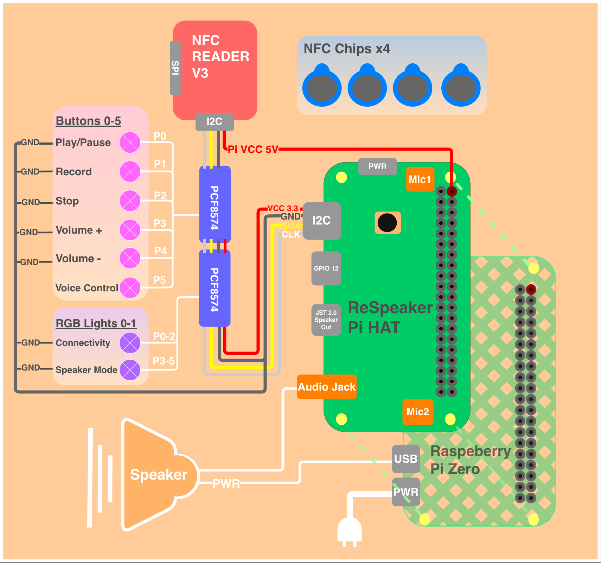

# Smart Speaker — Raspberry Pi IoT Project

A speaker you control with NFC chips. Tap a chip and the speaker loads the song that belongs to it
(green flash, short chime); press Play and it starts. Songs come from Spotify or from files on the
device. You can also record a voice clip onto the speaker, control it with six buttons or by voice,
and manage everything from a phone app or from a web page the speaker itself serves.

## Team

| Name | Role | Responsibilities |
|------|------|------------------|
| Daniella Shimon | Project Manager | Project planning, Flutter app development, testing, integration & deployment |
| Zohar Shtamberg | Tech Lead | System architecture, Raspberry Pi setup, hardware drivers (NFC, buttons, LEDs), Mopidy audio integration |
| Shiri Perechodnic | Creative Lead | 3D enclosure design, poster design, visual presentation |

---

## What it does

- **NFC chips.** A tap loads the chip; Play starts its song. A chip the speaker has never seen
  registers itself, so you can name it in the app and give it a song.
- **Spotify and local files.** Both play through Mopidy. Recordings and uploads are local files.
- **Voice recording.** Hold Record for five seconds and speak; the clip goes into the library.
- **Six buttons.** Play/Pause, Record, Stop, Volume up, Volume down, Push-to-Talk.
- **Voice commands.** Hold Push-to-Talk and say "hi speaker play". A few easter eggs are in there too.
- **Sound and light.** A short sound and a colour for every action.
- **Parental controls.** A volume cap, quiet hours, a daily limit, and a list of allowed chips.
  Every way of starting music goes through the same check.
- **Phone and web app.** The same Flutter app, either installed on a phone or served by the speaker
  in a browser. It shows what is playing, the volume and the minutes used today.
- **WiFi setup without a screen.** With no network for a minute the speaker opens its own hotspot
  and a setup page.
- **Health light and a health endpoint.** One light shows whether the parts are alive; `/health`
  says what is wrong.

## How it is put together

Four services run on the Pi, each on its own:

| Service | Program | What it does |
|---------|---------|--------------|
| `smart_speaker` | `Main/main.py` | The controller: buttons, NFC, recording, playback, lights 2 and 3 |
| `smart_speaker_server` | `Main/server_main.py` | The HTTP API on port 8080, and the web app |
| `smart_speaker_health` | `Main/health_monitor.py` | Light 1, and the volume-button long presses (reboot, restart services) |
| `smart_speaker_wifi` | `Main/wifi_provisioner.py` | Watches the network and runs the setup hotspot |

Music itself is played by **Mopidy** (MPD on port 6600); the controller only tells it what to play.
Short interface sounds go straight to the sound card through `aplay`, so they never fight the music.
Volume is the sound card's own `PCM` control, which means it survives a reboot.

The data (chips, library, parental controls, daily usage) lives in `Main/server_data.db`, a SQLite
database. Setting `SPEAKER_STORAGE=json` switches back to the older `server_data.json`; the data is
carried across either way. The controller writes what it is doing to
`/run/smart_speaker/status.json` once a second, and that file is what the health light and
`/health` read.

---

## Hardware

| Component | Model / specs | Qty | Purpose |
|-----------|---------------|-----|---------|
| Raspberry Pi | **Zero 2 W** (2.4 GHz WiFi only, ~415 MB RAM) | 1 | Main controller |
| Audio HAT | ReSpeaker 2-Mic HAT **v2.0** (TLV320AIC3x) | 1 | Sound out, microphones, I2C breakout |
| NFC reader | PN532, in I2C mode | 1 | Reads chip numbers |
| I/O expander | PCF8574 | 2 | Buttons (0x20) and LEDs (0x21) |
| RGB LEDs | 5 mm | 3 | Health, Push-to-Talk and Speaker status |
| Push buttons | Momentary | 6 | Play/Pause, Record, Stop, Vol+, Vol−, Push-to-Talk |
| Speaker | Powered speaker with a 3.5 mm input | 1 | Sound |
| NFC tags | NTAG213/215 | 4+ | The chips |
| Power supply | 5 V, 2.5 A or more, micro-USB | 1 | A weak supply causes random glitches |

The HAT is loaded by `dtoverlay=respeaker-2mic-v2_0` in `/boot/firmware/config.txt`. It becomes
ALSA card 0, `seeed2micvoicec`. Check with `aplay -l`.

### I2C addresses

All three devices hang off the HAT's I2C pins. Check them with `i2cdetect -y 1`.

| Device | Address |
|--------|---------|
| PCF8574, buttons | 0x20 |
| PCF8574, LEDs | 0x21 |
| PN532, NFC | 0x24 |

### Pins

Buttons are active-low on the expander at 0x20. The Speaker LED is split across both expanders,
because the LED expander ran out of pins.

| Expander | Pin | Use |
|----------|-----|-----|
| 0x20 | P0–P5 | Play/Pause, Record, Stop, Volume up, Volume down, Push-to-Talk |
| 0x20 | P6 | Speaker LED, red |
| 0x21 | P0, P1, P2 | Health LED: blue, green, red |
| 0x21 | P3, P4, P5 | Push-to-Talk LED: blue, green, red |
| 0x21 | P6, P7 | Speaker LED: blue, green |

### Wiring



> The picture is out of date: it shows two RGB LEDs, and the build has three (Health,
> Push-to-Talk and Speaker). It needs redrawing.

```
Raspberry Pi Zero 2 W
  │ micro-USB  ← 5 V supply
  │ GPIO header
  ▼
ReSpeaker 2-Mic HAT v2.0
  │ 3.5 mm jack  → powered speaker
  │ microphones  → recording and voice commands
  │ 3.3 V        → both PCF8574s
  │ SDA/SCL/GND  → all three I2C devices
  │ 5 V          → PN532 (it needs 5 V, not 3.3 V)
  ▼
PN532 (0x24)   PCF8574 (0x20, buttons)   PCF8574 (0x21, LEDs)
```

---

## Using it

### Buttons

| Button | Press | Hold |
|--------|-------|------|
| Play/Pause | Start or pause the music | 2 s: play the newest recording |
| Record | While recording: save it | 5 s (a countdown plays): start recording |
| Stop | Stop the music, or cancel a recording; with a chip loaded but idle, unload it | 3 s: unload the chip. While recording: cancel and keep the chip |
| Volume up | Louder | 5 s: reboot |
| Volume down | Quieter | 5 s: restart the services |
| Push-to-Talk | — | Hold and speak, then let go. Holding past 10 s counts as letting go |

Unloading a chip does not take the song off it; the voice command "clear" does that.

### Voice commands

Hold Push-to-Talk, say the phrase, let go. Start with "hi speaker" ("hey speaker", or just "hi" or
"hey", also work):

- "hi speaker **play**" — play or resume
- "hi speaker **pause**"
- "hi speaker **stop**"
- "hi speaker **clear**" — take the song off the loaded chip

Easter eggs work with or without the wake phrase: "shut up" (mute), "happy birthday",
"play despacito", "what is our grade", and "kill yourself" / "reboot" (which reboots the Pi).
They can be turned off in `Main/hardware/voice_command.py`.

### Lights

Each light shows only red, green or blue — no mixed colours.

**Light 1, Health** (the health service, or the WiFi service while it is setting up):

| Colour | Meaning |
|--------|---------|
| Green, solid | Everything answers |
| Blue, blinking | The controller is fine, but there is no internet or no API server |
| Red, blinking | Internet or the server is fine, but the controller is not running |
| Red, solid | Nothing answers |
| Blue, pulsing | Setup hotspot is up, or a volume button is being held |

**Light 2, Push-to-Talk:** off when idle, blue while listening and while the speech is being
worked out, three green blinks when the command was understood, three red blinks when it was not.

**Light 3, Speaker:** green while playing, blue when idle or paused, red while recording, a green
flash when a chip is loaded or something succeeded, three red flashes on an error.

---

## The app

The Flutter app in [flutter_app/](flutter_app/) talks to the speaker's API on port 8080. With it you
can see what is playing and how long the speaker has been used today, name chips and give them
songs, manage the library, upload songs, set the parental controls, and (on the phone build) use the
developer tools and the WiFi wizard.

Two ways to run it:

- **On a phone.** Build and install the app; point it at `http://rpi2.local:8080` or at the Pi's
  address.
- **In a browser.** The speaker serves the same app itself. Build it and send it over with
  `./scripts/dev/deploy_web.sh` (`--undo` puts the previous build back), then open
  `http://rpi2.local:8080`. The developer tools and the WiFi wizard are hidden in the browser
  version, because a browser cannot switch networks.

---

## WiFi setup

The speaker has no screen, so the first network is set from a phone.

1. Power it on. If no known network appears within 60 seconds, it starts the hotspot
   **SmartSpeaker-Setup** at `192.168.4.1` and Light 1 pulses blue. It does the same if the network
   disappears later while it is running.
2. Join that hotspot with a phone. The setup page should pop up by itself; if not, open
   `http://192.168.4.1:8080/wifi-setup`.
3. Pick your network, type the password, and watch the page.
4. The speaker joins your network — no reboot. Your phone loses the hotspot at that moment, so the
   page ends with a button, **"My phone is back on WiFi – open the speaker"**: put the phone back on
   your normal WiFi, press it, and it finds the speaker and opens the app. The app's own wizard has
   the same button.
5. If the password was wrong, the hotspot comes back so you can try again. While the hotspot is up
   and nobody is using it, the speaker tries the saved network again every two minutes.

The hotspot is open to anyone nearby. To lock it with WPA2, put `AP_PASSWORD` (at least 8
characters) in the `SECRETS` file.

Once the speaker is online, the app's developer tools can show the connection, scan, connect,
forget a network, or force the hotspot back on for testing.

---

## HTTP API

Port 8080, JSON in and out. Anything that is not one of these paths is served from the deployed web
app.

| Method | Path | Description |
|--------|------|-------------|
| GET | `/status` | What the speaker is doing, the loaded chip, volume, usage today, which store is in use |
| GET | `/health` | `ok`, `problems`, `warnings`, `server`, `controller`. 200 when well, 503 when not |
| GET | `/chips` | All chips |
| GET | `/chips/lookup?uid=` | One chip by its number, with its song |
| GET | `/library` | All songs |
| GET | `/settings/parental` | The parental controls |
| GET | `/usage/today` | Minutes played today |
| POST | `/chips` | Register a chip (`uid`, `name`) |
| POST | `/library` | Add a song (`name`, `uri`) |
| POST | `/files` | Upload an audio file, which is also added to the library |
| POST | `/usage/add` | Add played seconds |
| PUT | `/chips/{id}` · `/library/{id}` · `/settings/parental` | Change one |
| DELETE | `/chips/{id}` · `/library/{id}` | Remove one |
| DELETE | `/chips/{id}/assignment` | Take the song off a chip, keep the chip |

Developer tools: `GET /debug/system`, `/debug/logs`, `/debug/i2c`, `/debug/git-status`,
`/debug/speaker/status`; `POST /debug/speaker/start|stop|restart`, `/debug/git-pull`,
`/debug/daemon-reload`, `/debug/reboot`.

WiFi: `GET /debug/wifi/status`, `/debug/wifi/scan`, `/debug/wifi/connections`,
`/debug/wifi/connect-status`; `POST /debug/wifi/connect`, `/debug/wifi/disconnect`,
`/debug/wifi/forget`, `/debug/wifi/priority`, `/debug/wifi/ap-mode`. The setup page itself is
`GET /wifi-setup` and `POST /wifi-setup/connect`.

**Access:** there is no password. Anyone on the same network can read and change everything,
developer tools included — that is what the app uses. Other websites cannot read the answers from a
browser (one origin can be allowed with `SPEAKER_CORS_ORIGIN` while developing), and request bodies
are capped at 64 KB of JSON, 8 KB of form data and 30 MB for an upload. See PARAMETERS.md,
"API Access".

---

## Repository layout

```
Main/                       Python, runs on the Pi
  main.py                   the controller service
  server_main.py, server.py the HTTP API and the web app
  health_monitor.py         health light and volume long presses
  wifi_provisioner.py       network watch and setup hotspot
  setup.sh                  makes the venv and installs the Python packages
  core/                     state machine (controller.py, actions.py, state.py)
  hardware/                 NFC (nfc_scanner, nfc_service), buttons, leds, audio_player,
                            feedback_player, mixer, recorder, voice_command, mic_session,
                            wifi_manager, captive_responder, chip_store, health
  ui/                       sounds, lights, ui_controller
  storage/                  JSON and SQLite stores, the conversion between them, the rules
  utils/                    logging, the status file, shared folders, the server client
  config/                   settings.py (all the numbers), paths.py, tags.json (the old chip file)
  assets/sounds/            the interface sounds

flutter_app/                the phone and web app (screens, services, models)

services/                   what gets installed on the Pi
  smart_speaker*.service    the four systemd units
  audio/                    asound.conf and mopidy.conf, the reference sound configuration
  system/                   saved system log, log rotation
  system-files.txt          what goes where
  copy-and-enable-service.sh, install-wifi-provisioner.sh

scripts/
  dev/                      run off the Pi, they reach it over SSH: push_to_pi.sh,
                            deploy_web.sh, install_flutter.sh
  pi/                       run on the Pi: install, update, back up, report, smoke test,
                            hardware tests (see scripts/README.md)

tests/                      the automatic tests (pytest); the Pi-only libraries are faked
Unit-tests/                 small hardware scripts to run by hand on the Pi
docs/                       DEPLOYMENT.md, SPOTIFY.md, README_FIXES.md
BRINGUP.md                  from a cold Pi to a working speaker, step by step
```

---

## What it needs

| | Version | Notes |
|---|---|---|
| Raspberry Pi OS | Debian 13 "trixie", 64-bit | Kernel 6.18 on the project's Pi |
| Python | 3.10 or newer | 3.13.5 on the Pi; the code uses `str \| None` |
| Mopidy | 4.x | With mopidy-mpd 4.x and Mopidy-Spotify 5.x |
| NetworkManager | 1.42+ | `nmcli` drives the WiFi setup |
| Flutter | 3.x | Only to build the app |

Python packages are pinned in `requirements.txt`; the important ones are
`adafruit-circuitpython-pn532` (NFC), `smbus2` (I2C), `python-mpd2` (Mopidy),
`pyalsaaudio` (volume), `SpeechRecognition` (voice commands) and `requests`.

Spotify needs more than a package: a Premium account, a Web API login through
<https://auth.mopidy.com/spotify/> (which has to be redone about every six months) and a separate
streaming login. [docs/SPOTIFY.md](docs/SPOTIFY.md) explains how it works here and keeps a dated log
of what has broken and what fixed it.

---

## Installing and updating

**Read [BRINGUP.md](BRINGUP.md) first.** It walks from a Pi that has never been switched on to a
finished speaker, and [docs/DEPLOYMENT.md](docs/DEPLOYMENT.md) explains why the order is what it is:
system files first (git cannot undo those), then the code, then the data, then the app.

The short version. Steps 1, 2 and 4 are typed on the Pi; steps 3 and 5 are run against it over
SSH, from wherever you have the repository checked out and Flutter installed:

```bash
# 1. Python environment (on the Pi, as the normal user, not with sudo)
bash Main/setup.sh

# 2. Credentials
cp SECRETS.template SECRETS && nano SECRETS

# 3. Send the scripts and service files to /tmp/pi on the Pi
./scripts/dev/push_to_pi.sh iot-proj@rpi2.local

# 4. On the Pi, from /tmp/pi. Each one previews first and can be undone.
sudo ./pi_install_system.sh        # services, saved system log, log rotation
sudo ./pi_install_audio.sh         # shared sound card, Mopidy settings
./pi_update.sh main                # switch the code, restart, quick check

# 5. Build the web app and send it to the Pi
./scripts/dev/deploy_web.sh iot-proj@rpi2.local
```

To run the controller by hand, stop the service first and use the venv's Python, because the system
Python does not have the packages:

```bash
sudo systemctl stop smart_speaker
cd Main && ../venv/bin/python main.py
```

The service user needs `sudo` without a password for `nmcli`, for `systemctl restart` of the
speaker's own services, and for `reboot`. On the project's Pi, `iot-proj` already has passwordless
sudo, so nothing extra is installed.

The tests need no Pi and no hardware — the Pi-only libraries are faked:

```bash
python -m pytest -q
```

---

## When something is wrong

| Problem | Where to look |
|---------|---------------|
| NFC is not read | `i2cdetect -y 1` should show 0x24. A missing reader no longer stops the speaker: it retries every 5 s |
| Buttons do nothing | 0x20 on the I2C scan; `scripts/pi/test_buttons.py` |
| Lights do nothing | 0x21 on the I2C scan; `scripts/pi/test_leds.py` |
| No sound | `systemctl status mopidy`, `aplay -l`, then `scripts/pi/spotify_check.py` |
| Spotify will not play | [docs/SPOTIFY.md](docs/SPOTIFY.md) |
| A service will not start | `journalctl -u smart_speaker -b` (the Pi has no clock battery, so `--since` lies) |
| Voice commands fail | `arecord -l`, then `scripts/pi/test_ptt.py`. They need internet |
| Network trouble | Force the hotspot from the app, or join SmartSpeaker-Setup |
| Anything else | `scripts/pi/pi_report.sh` collects the facts into one file; `pi_smoke_test.py` checks the whole speaker |

Logs: `/var/log/smart_speaker/controller.log` (the controller, rotated by itself),
`/var/log/smart_speaker_server.log`, `/var/log/smart_speaker_health.log`,
`/var/log/smart_speaker_wifi.log`, and `journalctl -u <service>`.

---

## More documentation

- [BRINGUP.md](BRINGUP.md) — the checklist from a cold Pi to a finished speaker
- [docs/DEPLOYMENT.md](docs/DEPLOYMENT.md) — how the code gets onto the Pi, and the way back
- [docs/SPOTIFY.md](docs/SPOTIFY.md) — how Spotify works here, and the debugging log
- [PARAMETERS.md](PARAMETERS.md) — every number and setting, and where to change it
- [EDGE_CASES.md](EDGE_CASES.md) — what happens when things go wrong, and what the speaker does
- [USER_STORIES.md](USER_STORIES.md) — what the speaker is supposed to do, from the user's side
- [scripts/README.md](scripts/README.md) — what each script does and where it runs

---

## Credits

ICST — The Interdisciplinary Center for Smart Technologies  
Taub Faculty of Computer Science, Technion  
<https://icst.cs.technion.ac.il/>
